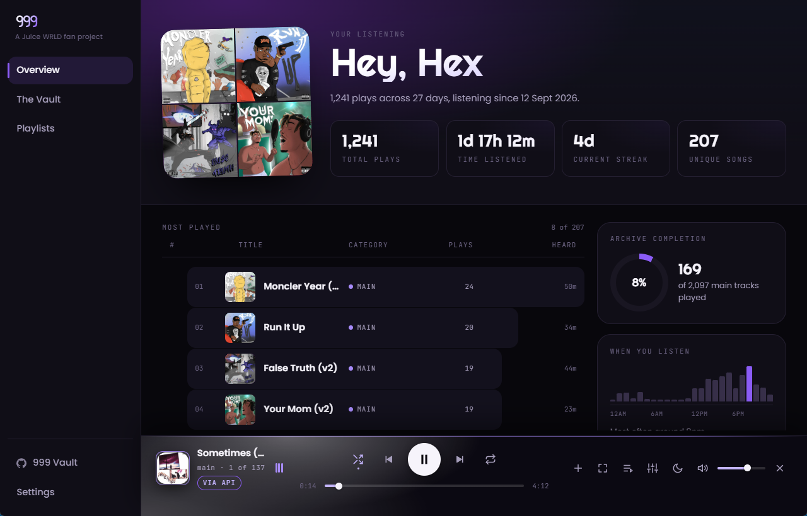
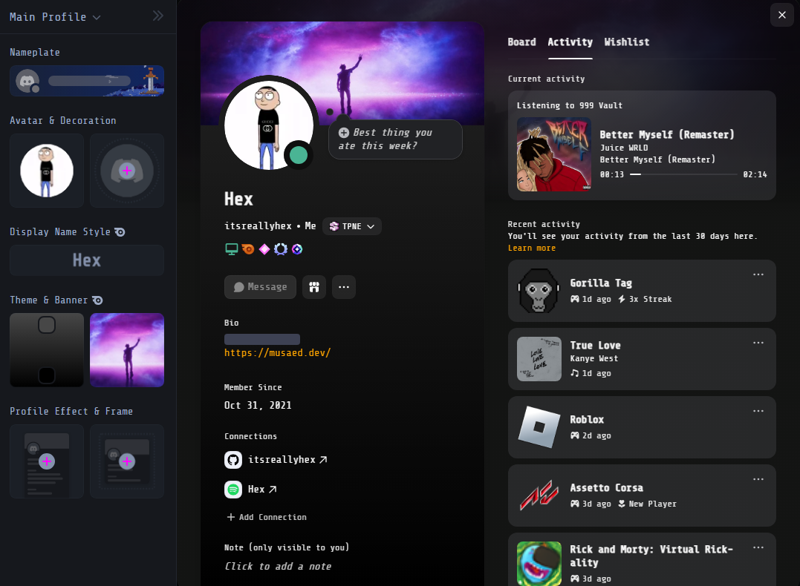

# 999

A desktop app over a public archive of unreleased songs. A listening
overview, the Vault, playlists, a player that keeps going while you move
around, and Discord Rich Presence.

An unofficial fan project, not affiliated with the estate of Jarad Higgins,
Grade A Productions or Interscope Records. Cover images belong to their
respective owners and are shown to identify recordings.



## Get it

Windows only for now. Download the installer from the
[latest release](https://github.com/itsreallyhex/999-vault/releases/latest)
and run it.

Install, open, listen. The installer carries the catalogue, so the app has
every record on first run with nothing else on the machine. Covers load from
the archive and songs stream from it.

Once it is installed it asks GitHub, a few seconds after opening, whether a
newer version is out. If there is one it tells you and offers Update or
Remind me later. Nothing installs unless you press the button. There is a
switch for the check in Settings.

## What it does

**The overview** is the page it opens on: plays, time listened, your
streak, your most played songs and the last two weeks. It is drawn from a
listening history the player writes on this machine as you go, so it
starts empty.

**The Vault** is the whole catalogue, in eight categories: main,
instrumental, stem, cut, released, remaster, acapella and freestyle. Search
matches alternate titles too, because the same song circulates under
several names. One click on a card opens its details, two play it.

**Playlists** live on this machine. They have a search box, and they can be
exported to a file and imported back.

**The player** sits outside the pages, so switching tabs never stops the
music. Close the app and open it again and it comes back on the song you
were on, at the same position, paused. A song that is not saved here
streams from the archive and the bar says `via API` while it does. The
arrow on the bar saves it to your archive folder, through the archive's
metered download, so the next play comes off disk.

**Settings** covers where songs come from first (files on this machine or
the archive), Discord, update checks, and which folder holds your archive.

**Discord** shows what is playing while the app and Discord are both open:
the title, the cover and a progress bar. Paused reads "Paused" with a
timer counting up. It can be turned off in Settings.



.png)

### On main, arriving in the next release

These are built and in the repo, and are not in the latest release yet.

- **The now playing screen.** After a while with nothing touched, or from the
  button on the bar, the window shows the cover large over a blurred copy of
  itself, with the title, a progress line and the lyrics.
- **Lyrics.** Timed lyrics follow the song and a line can be pressed to jump
  to it. They are looked up on [LRCLIB](https://lrclib.net) by song title
  and artist name, once per song, on a switch in Settings. A `.lrc` or
  `.txt` file named like the song works instead.
- **Up next.** A queue you can see, add to many songs at a time, and take
  songs out of. The same song can be queued more than once.
- **Select mode** on the Vault and on a playlist, to pick several songs and
  queue them together.
- **Sound lab.** Speed and pitch (slowed, sped up), reverb, bass boost and a
  ten band equalizer, with presets, kept per song or for every song.
- **Crossfade** between songs, off by default.
- **A sleep timer**, set from the bar, off until you choose one.
- **Check for new songs** in Settings: it asks the archive what it has now,
  shows what is new, and changes nothing until you press Update.
- **Keyboard shortcuts**: Space plays and pauses, Left and Right skip,
  Ctrl with Left or Right changes the volume, Escape closes the now playing
  screen or a panel.

## What it talks to

No accounts, no analytics, no telemetry.

| To | For | When |
|---|---|---|
| The archive's public API (`api.juicevault.xyz`) | the catalogue, covers, streaming, saving a song | when you play, browse or save |
| GitHub | the update check | a few seconds after the app opens, if the switch is on |
| LRCLIB | lyrics, sending a song title and the artist name and nothing else | only while the now playing screen is up, if the switch is on |
| Discord, on this machine | Rich Presence, over Discord's local pipe | while the app and Discord are open, if the switch is on |

The app holds no audio of its own. Songs stream from the archive, and what
you save comes from the same place. The archive limits anonymous downloads
to 500 a day.

## Your archive folder

With nothing set, the app uses the catalogue it shipped with and streams
songs. If you already hold the archive on disk, point it there in Settings
(or with `data_root` in `%APPDATA%\xyz.juicevault.nine\config.toml`) and it
reads the saved catalogue, covers and audio from that folder instead. The
folder is read in this order, first hit winning: the `NINE_DATA_ROOT`
environment variable, `data_root` in the config file, a `data` folder beside
the exe, a `data` folder in the OS app data directory.

## Building it yourself

```bash
cd desktop
npm install
npx tauri build
```

That writes `src-tauri/target/release/vault999.exe` and an NSIS and an MSI
installer next to it. You need Rust and, on Windows, the Visual Studio
*MSVC v143 C++ x64/x86 build tools* and a *Windows 11 SDK*. Run cargo from
PowerShell, not Git Bash: Git's own `link.exe` shadows the MSVC linker.

Release builds are signed for the updater with a private key that is not in
this repo, so `npx tauri build` stops without one. Make your own with
`npx tauri signer generate` and set `TAURI_SIGNING_PRIVATE_KEY` (and its
password). An app signed with your key will not update from this project's
releases. `npm run dev` is for working on the Rust side.

The pages are read from disk at runtime, so editing them needs no rebuild.
`desktop/README.md` has the longer notes.

## The browser version

`web/` is an earlier, browser-only version of the Vault with a small local
Python server and the scripts that saved the catalogue. It is kept as it
was and is not updated. The app is where the work is.
